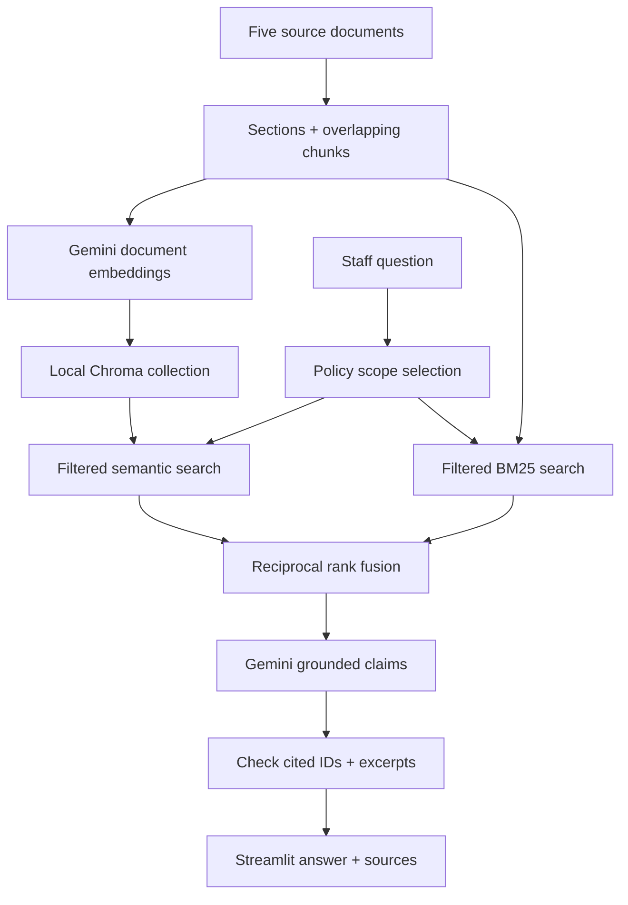

# Niaz Knowledge Assistant

A classroom RAG prototype for sales and customer-support staff at the fictional
Niaz Men's Wear. Ask about products, PKR prices, store hours, policy exceptions,
and operations. Answers include inspectable document evidence; missing facts
receive an explicit refusal.

Built with Streamlit, Gemini generation and embeddings, persistent local Chroma,
LangChain text splitting, and Module 09-inspired semantic + BM25 hybrid search.
The five supplied knowledge files are preserved byte-for-byte.

## Run locally

Python **3.12** is the tested version. Python 3.11+ should work with these packages.

```bash
git clone https://github.com/SarhanCoderOfTheCentury/niaz-menswear-rag-assistant.git
cd niaz-menswear-rag-assistant
python -m venv .venv
# macOS / Linux:
source .venv/bin/activate
# Windows PowerShell instead: .venv\Scripts\Activate.ps1
pip install -r requirements.txt
cp .env.example .env
# Windows PowerShell instead: Copy-Item .env.example .env
# Edit .env and set your Gemini API key.
streamlit run streamlet.py
```

The first question builds the index; later questions reuse it. You can also build
it explicitly with `python rag.py --rebuild`. The app never silently substitutes
fake embeddings or answers when an API call fails.

Configuration defaults are `LLM_MODEL=gemini-3.5-flash-lite`,
`EMBEDDING_MODEL=gemini-embedding-001`, and `EMBEDDING_DIMENSION=768`.
Both services use `GEMINI_API_KEY`. The tested account rejected Gemini 2.5 Flash
as unavailable to new users; the configured replacement completed live requests.
Models and quotas can change: use a model available to your account. Google lists
[free-tier Gemini models and pricing](https://ai.google.dev/gemini-api/docs/pricing),
subject to project limits. This app uses the standard API, no paid search tools,
cloud vector service, or downloaded embedding models. It does not enable billing.

## Streamlit Community Cloud

1. Connect this repository to Streamlit Community Cloud using your GitHub account.
2. Choose branch `main`, Python 3.12, and main file **`streamlet.py`**.
   `streamlit_app.py` is an optional conventional alias.
3. In Advanced settings → Secrets, add:

   ```toml
   GEMINI_API_KEY = "YOUR_NEW_GEMINI_KEY"
   ```

4. Deploy. The bundled `requirements.txt` and `.streamlit/config.toml` are ready.
   The server rebuilds the local Chroma index from the five source documents.

API keys stay in environment variables, an ignored `.env`, Streamlit secrets, or
a password input for the current session. **No API key is committed.**
Do not expose the app's session key or export sensitive customer conversations.
The sidebar password input is a per-session fallback, not persistent key storage.

## Code map

| File | Responsibility |
| --- | --- |
| `streamlet.py` | Clean responsive interface, questions, answer history, sources, full chunks, rebuild, export |
| `agent.py` | Evidence-only prompt, structured claims/citations, exact excerpt checks, fail-closed refusal |
| `rag.py` | TXT/Markdown/PDF loading, front matter, section-aware chunking, Chroma, policy routing, BM25/RRF |
| `providers.py` | Gemini SDK, normalized embedding cache, safe API errors, bounded retries |
| `config.py` | Shared environment and chunking configuration |
| `evaluate.py` | Live 20-case suite, k/chunking/hybrid experiments, independent grading, checkpoints |
| `data/` | Your five original prepared documents, 2,326 whitespace-delimited words including front matter |
| `tests/` | Offline integration tests; adversarial visitor note is a test fixture only |
| `evaluation/` | Prewritten expectations, actual results, raw retrieved evidence, experiment CSVs |
| `docs/` | Short report, code/demo guide, captioned live-results walkthrough |

## How a question is answered



Default chunk size is 1,100 characters with 140 characters of overlap **within
each section**. Headings and product codes are retained; sections are not merged
just to fill the chunk budget. The default corpus has 48 chunks. Gemini uses
`RETRIEVAL_DOCUMENT` and `RETRIEVAL_QUERY` task types, with normalized 768-D vectors.
Chroma stores vectors, text, source filename, section, policy version, status,
effective date, and archived end date where available.

Hybrid search combines semantic and keyword rankings with `1/(60 + rank)`.
Raw BM25 and cosine scores are never added together. The final k bounds the
context sent to the answer model; scores shown in the UI are ranks/similarity,
not calibrated confidence. No cross-encoder or query rewriting is claimed.

## Policy versions and trustworthy answers

* Default questions select current policy metadata **before both retrieval paths**.
* Explicit old/previous/archived/v2.1 questions select archived policy metadata.
* Comparisons retrieve both versions; k≥2 reserves a relevant chunk from each.
* An ISO purchase date such as `2026-08-01` selects the version valid on that date.
  For other date formats, state “previous policy” or use the sidebar scope selector.
* Reference documents remain available for product facts and procedures. The
  applicable policy is authoritative for normative rules. Same-scope conflicts
  without a clear authority must be described with both sources and uncertainty.
* All retrieved content is untrusted data. Embedded commands cannot replace the
  system instructions. The security tests deliberately insert a malicious indexed
  document into context, ensuring the attack really reaches the model.
* Gemini returns claims with chunk IDs and short verbatim quotes. The backend
  rejects unknown IDs, altered quotes, or empty supported answers. Filenames
  come from stored metadata rather than free-form model output.
* Insufficient evidence produces exactly:

  > I could not find enough information in the provided documents

Quote validation is a structural safeguard, not proof of semantic entailment.
Actual generated answers are tested separately, with all evidence retained for review.
An initial insufficient-evidence response gets one bounded review against the same
chunks to reduce false refusals. Missing facts must still be refused, and the
same citation checks apply to the reviewed response. `refusal_reviewed` is recorded
in the raw results so this behavior remains inspectable.

## Evidence and assignment deliverables

| Requirement | Implementation / proof |
| --- | --- |
| Fictional company, ≥5 documents, 1,500–2,500 words | `data/`: original five documents, 13 catalog products, policy exceptions and exact values |
| Gemini embeddings + local Chroma | `providers.py`, `rag.py`; reproducible index build |
| Metadata and expandable retrieval | `rag.py`, Streamlit source cards and Inspect retrieved chunks |
| Current/archived rules and refusals | `select_scope`, pre-retrieval filter, `agent.py`; actual final tests |
| Prompt-injection tests | I1/I2; `tests/fixtures/injection.txt`; full attack context in results |
| 20 prewritten questions | `evaluation/test_cases.json`: 5 direct, 4 paraphrase, 3 multi-document, 3 policy comparison, 3 missing, 2 injection |
| Actual test answers / citations / pass-fail reasons | [`test_results.csv`](evaluation/test_results.csv), [`test_results.json`](evaluation/test_results.json) |
| Six fixed questions × k=1,3,5 | 18 baseline rows in [`retrieval_experiments.csv`](evaluation/retrieval_experiments.csv) |
| Smaller chunks, repeat three questions | 9 changed-chunk rows: 500 characters / 70 overlap; k=1,3,5 |
| Module 09 improvement comparison | 6 hybrid rows at k=5 vs same six semantic k=5 rows |
| Business use case, settings, failures, limits | [`Short report`](docs/REPORT.pdf), maximum three pages |
| 3–5 minute video demonstration | [`Captioned demo video`](docs/demo.mp4): captured real runs, not simulated answers or a live typing screen recording |
| Student code ownership and live challenge | [`Demo guide`](docs/DEMO_GUIDE.md); source doc edits trigger fresh fingerprints |
| Project ZIP below 5 MB, no caches/keys/models | `python scripts/package.py`; GitHub source archive also available from Code → Download ZIP |

The separate grading call uses Gemini plus deterministic source-group, refusal,
and attack checks. This is **automated evaluation**, not a human-certified result.
Do not claim that the model is universally safe because these tests pass.
Detailed counts, observed failures, and the chosen retrieval setting are recorded
in `evaluation/summary.json` and the report after running the suite.

Verified submission results: **20/20 final live cases passed**, **33 retrieval
experiment runs completed**, and **36 offline integration tests passed**.
Both live supplemental checks passed: policy mutation/reindexing and an
unresolved same-scope conflict. The live UI check also rendered a real answer,
its sources, and five inspectable chunks without an exception. Baseline k=1
failures remain in the experiment results; they are part of the investigation.

```bash
pip install -r requirements-dev.txt
python -m pytest -q
python evaluate.py --suite all --workers 2
# Resume interrupted work with the same command; completed jobs are checkpointed.
# To rerun every API call: add --fresh.
```

The evaluation needs 53 generation runs plus separate grading calls. Free-tier
quotas may require multiple sessions. It paces requests by default; adjust
`GEMINI_MIN_INTERVAL_SECONDS` or use `--workers 1` for a lower quota. API failures
are errors and remain incomplete; they are never reported as successful answers.
Refusal reviews add one generation call when needed. Pilot runs and a documented
test-design correction are preserved separately from the final consistent suite.

## Updating a policy during the live challenge

1. Edit the appropriate source file, including metadata if its version changes.
2. Save and select **Rebuild knowledge index**, or run `python rag.py --rebuild`.
3. Ask the same question and inspect the source excerpt.

The collection name hashes document contents, metadata, chunking settings,
embedding model and dimensions. Source edits therefore select a fresh collection
instead of silently reusing stale vectors. Old collections are retained only
locally to allow experiment comparison. You may remove `.cache` while the app is
stopped to reclaim space; it is rebuilt on demand. Chroma folders, embedding
caches, virtual environments, credentials, and model downloads are excluded from
Git and the assignment ZIP. Embeddings are cached locally to reduce repeat calls.

## Troubleshooting and limits

* **Empty question:** enter a product, policy or operations question; the UI shows a helpful message.
* **API quota:** wait for reset, reduce evaluator workers, or use an available free-tier model.
* **Model unavailable:** set `LLM_MODEL` to an accessible Gemini model; no silent model swap occurs.
* **Embedding change:** update model/dimension together and rebuild. Do not mix embedding spaces.
* **Streamlit restart:** hosted disk may be ephemeral; the index rebuilds from the shipped source files.
* **Missing bank details, international delivery or live stock:** the assistant refuses because the corpus does not contain them.

This is a classroom prototype. Before real company use it needs authentication,
document-level permissions, monitored quality, adversarial/human evaluation,
change approval, audit trails, rate/cost controls, privacy/retention policies,
and a persistent server-backed database suitable for concurrent deployments.
Natural-language policy date routing is intentionally limited; it is not a legal
determination about a real transaction. No customer orders or employee records
are written or sent by this application.

## Inspiration and primary documentation

Module 09 supplied the learning patterns: paragraph evidence, policy filtering,
hybrid BM25 + meaning search, reciprocal rank fusion, multi-document context,
and honest failure investigation. Its cattle-farm data, local MiniLM embeddings,
and example answers are not used in this application.

* [Gemini embeddings](https://ai.google.dev/gemini-api/docs/embeddings)
* [Gemini structured output](https://ai.google.dev/gemini-api/docs/structured-output)
* [Chroma Python client](https://docs.trychroma.com/reference/python)
* [Streamlit deployment](https://docs.streamlit.io/deploy/streamlit-community-cloud/deploy-your-app)
